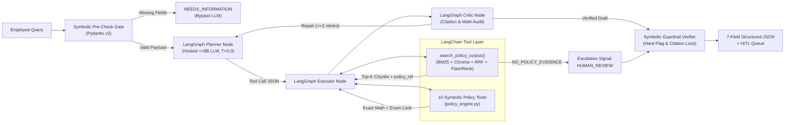

# T&E Policy Agent — Hybrid RAG & Symbolic Policy Pipeline

This module implements the **Retrieval-Augmented Generation (RAG)** and **Deterministic Symbolic Policy Engine** layers for the AI Travel & Expense (T&E) Policy Copilot.

Designed to run reliably with a **hosted instruction model ($\le 8\text{B}$ parameters)**, this pipeline follows a **Hybrid Neuro-Symbolic Architecture**:
* **Neural Layer (RAG + $\le 8\text{B}$ LLM):** Retrieves grounded policy clauses, parses user intent, orchestrates tool calls, and explains decisions.
* **Symbolic Layer (Deterministic Python + Policy Tables):** Executes all financial arithmetic, validates completeness, enforces hard policy locks, and resolves human approval hierarchies.

---

## 1. Core Architectural Principle: Single Source of Truth (SSOT)

To guarantee that retrieved policy citations never contradict deterministic tool calculations, both layers are compiled from a single canonical definition (`scripts/build_corpus.py`):

1. **`data/corpus/te_policy_corpus.jsonl`** (~745 documents): Global/regional policies, city-tier hotel & per diem rate tables, mileage circulars, receipt rules, vendor addenda, approval matrices, exception FAQs, and superseded 2024/2025 circulars (for temporal filtering tests).
2. **`data/policy_tables/policy_tables.json`**: Structured rate tables and rules consumed directly by the 10 deterministic tools.

---

## 2. Project Structure

```text
rag-pipeline/
├── data/
│   ├── corpus/
│   │   └── te_policy_corpus.jsonl        # 745-doc policy corpus (685 ACTIVE, 60 SUPERSEDED)
│   ├── policy_tables/
│   │   └── policy_tables.json            # SSOT tables for the 10 symbolic tools
│   ├── chroma_db/                        # Persistent ChromaDB vector store
│   └── cache/
│       └── embedding_cache.json          # SHA-256 local cache for hosted embeddings
├── scripts/
│   ├── build_corpus.py                   # SSOT corpus + policy tables generator
│   └── calibrate_gate.py                 # Empirical calibration for Low-Confidence Gate
├── src/
│   ├── rag/
│   │   ├── chunker.py                    # Table-preserving, header-aware semantic chunker
│   │   ├── metadata.py                   # Flat ChromaDB metadata normalizer
│   │   ├── ingest_chroma.py              # Hosted embeddings client + ChromaDB upsert
│   │   ├── inspect_chunks.py             # Min/max/median chunk size inspector
│   │   └── hybrid_retriever.py           # BM25 + ChromaDB + RRF + FlashRank + Gate
│   └── tools/
│       └── policy_engine.py              # 10 deterministic symbolic T&E policy tools
├── tests/
│   ├── test_policy_engine.py             # 30 unit tests across all 10 tools & 5 statuses
│   └── test_low_confidence_gate.py       # Out-of-policy / NO_POLICY_EVIDENCE gate test
└── README.md
```

---

## 3. RAG Pipeline Breakdown

| Stage | Component | Implementation Details |
| :--- | :--- | :--- |
| **1. Chunking** | `src/rag/chunker.py` | **Table-preserving & header-aware semantic chunking** (variable 80–450 tokens). Markdown tables are never split mid-row; every chunk is prefixed with `[policy_ref] Title`. |
| **2. Metadata** | `src/rag/metadata.py` | Attaches flat ChromaDB-compatible metadata: `doc_id`, `section_id`, `policy_ref`, `region`, `grade_scope`, `grade_band`, `expense_category`, `effective_date`, `effective_date_int`, `status`. |
| **3. Embeddings & Store** | `src/rag/ingest_chroma.py` | Calls an OpenAI-compatible **Hosted Embeddings API** (batched at `BATCH_SIZE = 16` with SHA-256 caching and `tenacity` backoff) and upserts into persistent **ChromaDB** (`cosine` space). |
| **4. Hybrid Retrieval** | `src/rag/hybrid_retriever.py` | Pre-filters by `status == "ACTIVE"`, `region`, `expense_category`, and `grade_band`. Runs **BM25** (top-25) + **ChromaDB Dense Search** (top-25), fuses via **Reciprocal Rank Fusion (RRF, $k=60$)** to top-15, and reranks with **FlashRank** (`ms-marco-MiniLM-L-12-v2`) to return top 3–5 chunks. |
| **5. Low-Confidence Gate** | `src/rag/hybrid_retriever.py` | If the top reranked chunk falls below the calibrated `confidence_threshold` (e.g., unlisted destination like *Thimphu* or *Antarctica*), emits `status: "NO_POLICY_EVIDENCE"` to force `HUMAN_REVIEW`. |
| **6. Symbolic Engine** | `src/tools/policy_engine.py` | Implements all 10 deterministic tools (`check_travel_eligibility`, `validate_flight_booking`, `validate_hotel_limit`, `calculate_meal_per_diem`, `validate_expense_claim`, `verify_receipt_requirement`, `validate_mileage_claim`, `resolve_approval_hierarchy`, `classify_exception_route`, `build_policy_recommendation_hints`). |

---

## 4. Interaction with Orchestration (LangGraph / LangChain)

The RAG pipeline is **not** a passive text-stuffing chain. In the T&E Policy Agent, it operates as a **typed, callable tool inside a stateful LangGraph (`Planner → Executor → Critic`) orchestration loop**, backed by LangChain tool schemas and a deterministic post-check guardrail.

### End-to-End Interaction Flow



### How Each Orchestration Layer Interacts with RAG

1. **Tool Binding (LangChain `@tool` / Pydantic Schemas):**
   `HybridPolicyRetriever.search_policy_corpus()` and the 10 methods of `SymbolicPolicyEngine` are wrapped as LangChain tools with strict Pydantic input schemas. This allows the $\le 8\text{B}$ model to pass structured metadata filters (`region="IN"`, `grade="L3"`, `expense_category="hotel"`) instead of relying on unstructured semantic search alone.

2. **Planner Node (Query Formulation & Tool Selection):**
   The Planner never answers from parametric memory. On every policy evaluation turn, it plans a sequence of tool calls:
   * Calls `search_policy_corpus(...)` to retrieve authoritative `policy_ref` clauses and exception FAQs.
   * Calls the relevant deterministic tool(s) (e.g., `validate_hotel_limit`, `verify_receipt_requirement`, `resolve_approval_hierarchy`) to obtain exact caps, variances, and approval levels.

3. **Executor Node (Parallel/Sequential Tool Execution & State Accumulation):**
   The Executor invokes the RAG retriever and symbolic tools, catches API/timeout errors, and appends two distinct artifacts to the LangGraph `AgentState`:
   * `retrieved_policy_refs`: The exact set of `policy_ref` IDs returned by `search_policy_corpus()` during this trace.
   * `symbolic_results`: The structured JSON outputs from the deterministic tools (including any `NO_POLICY_EVIDENCE` gate signals).

4. **Critic Node & Self-Repair Loop ($\le 2$ Retries):**
   Before finalizing, the Critic audits the Planner's draft against the LangGraph state:
   * Verifies that every cited `policy_ref` exists in `retrieved_policy_refs`.
   * Verifies that `allowed_expense_amount` matches the symbolic tool output.
   * If the $\le 8\text{B}$ model produces malformed JSON or misses a citation, the Pydantic `ValidationError` is routed back to the Planner for up to 2 self-repair retries before safely failing over to `HUMAN_REVIEW`.

5. **Symbolic Guardrail Verifier (Deterministic Post-Check Lock):**
   After the LangGraph loop exits, a deterministic Python verifier enforces immutable compliance locks:
   * **Hard-Flag Lock:** If any symbolic tool emitted `HARD_FLAG`, the LLM cannot downgrade it to `SOFT_FLAG` or `PASS`.
   * **Low-Confidence Lock:** If `search_policy_corpus()` returned `NO_POLICY_EVIDENCE`, the decision is locked to `HUMAN_REVIEW` and routed to the Finance Policy Desk.
   * **Citation Integrity:** Any `policy_ref` not present in the trace's `retrieved_policy_refs` is stripped, triggering `HUMAN_REVIEW`.
   * **Multi-Turn Persistence:** When `NEEDS_INFORMATION` is returned, LangGraph's checkpointer (SQLite/Redis) persists the session state so the employee's follow-up reply (e.g., providing their grade or travel dates) resumes cleanly without losing prior context.

### Minimal LangChain Tool Wrapper Example

```python
from langchain_core.tools import tool
from src.rag.hybrid_retriever import HybridPolicyRetriever
from src.tools.policy_engine import SymbolicPolicyEngine

retriever = HybridPolicyRetriever(confidence_threshold=0.55)
engine = SymbolicPolicyEngine()

@tool
def search_policy_corpus(
    query: str,
    region: str | None = None,
    expense_category: str | None = None,
    grade: str | None = None,
) -> dict:
    """Retrieve active corporate T&E policy clauses using Hybrid RAG (BM25 + Vector + Rerank)."""
    return retriever.search_policy_corpus(
        query=query,
        region=region,
        expense_category=expense_category,
        grade=grade,
        top_k=5,
    )

@tool
def validate_hotel_limit(
    grade: str,
    city: str,
    nightly_rate: float,
    nights: int,
    travel_month: str,
    region: str | None = None,
) -> dict:
    """Deterministically validate a hotel nightly rate against city-tier and seasonal caps."""
    return engine.validate_hotel_limit(
        grade=grade,
        city=city,
        nightly_rate=nightly_rate,
        nights=nights,
        travel_month=travel_month,
        region=region,
    )
```

---

## 5. Setup & Installation

### Prerequisites
* Python 3.11+
* Access to an OpenAI-compatible Hosted Embeddings API

### Install Dependencies
```bash
pip install chromadb openai tenacity python-dotenv rank-bm25 flashrank pytest truststore
```

### Environment Configuration (`.env`)
Place a `.env` file in your project root:
```env
EMBEDDING_BASE_URL=https://api.openai.com/v1
EMBEDDING_API_KEY=your_api_key_here
EMBEDDING_MODEL=text-embedding-3-small
```

> **Windows / Corporate Proxy Note:** If you encounter `CERTIFICATE_VERIFY_FAILED` behind a corporate proxy/VPN, ensure `import truststore; truststore.inject_into_ssl()` is enabled at the top of `ingest_chroma.py` and `hybrid_retriever.py`.
>
> **Batch Size Note:** `ingest_chroma.py` uses `BATCH_SIZE = 16` to stay compatible with hosted embedding providers that enforce a 16-item per-request cap.

---

## 6. Running the Pipeline & Tests

Run all commands from the `rag-pipeline/` directory:

1. **Generate the SSOT Corpus & Policy Tables:**
   ```bash
   python scripts/build_corpus.py
   ```
2. **Ingest Chunks & Hosted Embeddings into ChromaDB:**
   ```bash
   python -m src.rag.ingest_chroma
   ```
3. **Inspect Chunk Size Distribution (Min / Max / Median):**
   ```bash
   python -m src.rag.inspect_chunks
   ```
4. **Test Hybrid Retrieval (BM25 + ChromaDB + RRF + FlashRank):**
   ```bash
   python -m src.rag.hybrid_retriever
   ```
5. **Calibrate the Low-Confidence Gate:**
   ```bash
   python -m scripts.calibrate_gate
   ```
6. **Run Unit Tests (All 10 Symbolic Tools + Low-Confidence Gate):**
   ```bash
   python -m pytest -v tests/test_policy_engine.py tests/test_low_confidence_gate.py
   ```