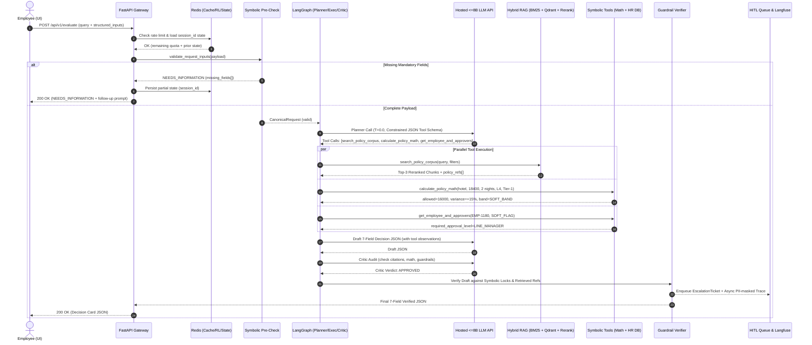

# Service Communication & Payload Contracts: AI T&E Policy Agent

**Document type:** Inter-Service Communication Specification  
**Project:** Travel & Expense (T&E) Policy Agent  
**Reference:** `project_scope.md` | `system_architecture.md` | `data/evaluation/gold_eval_v1.jsonl`

---

## 1. Service-to-Service Communication Matrix

All services communicate using strictly typed JSON contracts validated by **Pydantic v2**. External API calls (Hosted $\le 8\text{B}$ LLM, Hosted Embeddings, Observability) are isolated behind async clients with timeouts, exponential backoff, and fail-safe fallbacks to `HUMAN_REVIEW`.

| Source Service | Target Service | Protocol / Transport | Payload Format | Timeout / Retry Policy |
| :--- | :--- | :--- | :--- | :--- |
| **Client UI** (Streamlit / React) | **FastAPI Gateway** | HTTPS / REST (`POST /api/v1/evaluate`) | JSON (Request + `session_id`) | 30s timeout; no auto-retry on 4xx |
| **FastAPI Gateway** | **Redis** (Rate Limit / Cache / State) | TCP / RESP | Key-Value / JSON strings | 200ms timeout; fail-open on cache miss |
| **FastAPI Gateway** | **Symbolic Pre-Check Gate** | In-process Python Async | Pydantic `CanonicalRequest` | < 5ms; deterministic |
| **LangGraph Planner / Critic** | **Hosted $\le 8\text{B}$ LLM API** | HTTPS / OpenAI-Compatible REST | JSON + `response_format` schema | 12s timeout; up to 2 schema-repair retries |
| **LangGraph Executor** | **Hybrid RAG Service** | Internal Async / HTTP | `SearchPolicyInput` $\rightarrow$ `PolicyChunk[]` | 5s timeout; 1 retry on 5xx |
| **Hybrid RAG Service** | **Hosted Embeddings API** | HTTPS / OpenAI-Compatible REST | Text batch $\rightarrow$ float32 vector | 5s timeout; Redis-cached by SHA-256 |
| **Hybrid RAG Service** | **Qdrant Vector DB** | gRPC / HTTP | Vector + Metadata filter $\rightarrow$ Top-25 | 1s timeout |
| **LangGraph Executor** | **Deterministic Tools** (Math / HR) | In-process Python $\rightarrow$ SQLite/Postgres | Strict Pydantic Tool I/O | 500ms timeout; deterministic |
| **Guardrail Verifier** | **HITL Escalation Queue** | Async Queue / Internal REST | `EscalationTicket` JSON | 3s timeout; dead-letter queue fallback |
| **All Pipeline Nodes** | **Langfuse / OpenTelemetry** | Async HTTPS Batch (Non-blocking) | PII-redacted Trace Spans | Fire-and-forget background worker |

---

## 2. End-to-End Service Sequence Diagram

The diagram below illustrates a complete evaluation flow (e.g., `SOFT_FLAG` hotel overage) showing how the Gateway, Pre-Check Gate, LangGraph Orchestrator, Hosted $\le 8\text{B}$ LLM, Hybrid RAG, Deterministic Tools, Guardrail Verifier, and HITL Queue coordinate.



---

## 3. Concrete Inter-Service Examples

### Example A: Full Pipeline Walkthrough — `SOFT_FLAG` (`EVAL-004`)
**Scenario:** `EMP-1180` (Grade L4, Product) stayed 2 nights in Bengaluru (`Rs 18,400` total, `Rs 9,200/night`) due to a tech conference surge. Grade L4 Tier-1 cap is `Rs 8,000/night`.

#### Step 1: Client UI $\rightarrow$ FastAPI Gateway
```http
POST /api/v1/evaluate HTTP/1.1
Content-Type: application/json
X-Request-ID: req_eval004_9f8a
Authorization: Bearer <employee_sso_jwt>
```
```json
{
  "session_id": "sess_emp1180_01",
  "user_query": "EMP-1180 (Grade L4, Product) stayed 2 nights in Bengaluru (Nov 15-17, 2026) for PRJ-PRD-019. Hotel bill is Rs 18,400 total (Rs 9,200/night) with GST invoice, due to a tech conference surge.",
  "structured_inputs": {
    "employee_id": "EMP-1180",
    "employee_grade": "L4",
    "department": "Product",
    "travel_destination": "Bengaluru",
    "travel_dates": {
      "start_date": "2026-11-15",
      "end_date": "2026-11-17",
      "booking_date": "2026-11-10"
    },
    "expense_category": "hotel_accommodation",
    "expense_amount": { "value": 18400, "currency": "INR" },
    "receipt_info": { "provided": true, "type": "hotel_gst_invoice", "itemized": true },
    "project_code": "PRJ-PRD-019"
  }
}
```

#### Step 2: FastAPI Gateway $\rightarrow$ Symbolic Pre-Check Gate
The Pre-Check validates all mandatory fields for `hotel_accommodation` (`employee_id`, `employee_grade`, `travel_destination`, `travel_dates`, `expense_amount`, `receipt_info`).
```json
{
  "is_complete": true,
  "missing_required_fields": [],
  "derived_nights": 2,
  "proceed_to_agent": true
}
```

#### Step 3: LangGraph Planner $\rightarrow$ Hosted $\le 8\text{B}$ LLM API
The Planner invokes the OpenAI-compatible endpoint (`temperature: 0.0`) with strict tool definitions. The LLM responds with structured tool calls:
```json
{
  "tool_calls": [
    {
      "id": "call_01",
      "name": "search_policy_corpus",
      "arguments": {
        "query": "Grade L4 Tier-1 Bengaluru hotel accommodation cap and exception threshold",
        "filters": { "expense_category": "hotel_accommodation", "region": "IN" }
      }
    },
    {
      "id": "call_02",
      "name": "calculate_policy_math",
      "arguments": {
        "category": "hotel_accommodation",
        "claimed_amount": 18400,
        "currency": "INR",
        "units": 2,
        "employee_grade": "L4",
        "destination": "Bengaluru"
      }
    },
    {
      "id": "call_03",
      "name": "get_employee_and_approvers",
      "arguments": {
        "employee_id": "EMP-1180",
        "violation_band": "SOFT_BAND",
        "amount": 18400
      }
    }
  ]
}
```

#### Step 4: LangGraph Executor $\leftrightarrow$ Hybrid RAG & Deterministic Tools
* **Hybrid RAG Response (`search_policy_corpus`):**
```json
{
  "status": "OK",
  "retrieval_metrics": { "bm25_hits": 25, "dense_hits": 25, "reranked_top_k": 2 },
  "chunks": [
    {
      "policy_ref": "POL-TRV-03#2.1",
      "rerank_score": 0.94,
      "text": "Tier-1 Indian cities (Bengaluru, Mumbai, Delhi NCR, Hyderabad, Chennai, Pune, Kolkata) have a nightly lodging cap of Rs 8,000 for Grade L4 employees, excluding taxes."
    },
    {
      "policy_ref": "POL-EXC-01#1.2",
      "rerank_score": 0.89,
      "text": "Hotel rate overages up to 20% above the applicable grade cap due to peak/conference surge are classified as SOFT_FLAG and require written justification plus Line Manager approval."
    }
  ]
}
```
* **Deterministic Math Tool Response (`calculate_policy_math`):**
```json
{
  "city_tier": "TIER_1",
  "per_unit_cap": 8000,
  "units": 2,
  "allowed_amount": 16000,
  "claimed_amount": 18400,
  "variance_amount": 2400,
  "variance_pct": 15.0,
  "currency": "INR",
  "compliance_band": "SOFT_BAND"
}
```
* **HR / Approver Tool Response (`get_employee_and_approvers`):**
```json
{
  "employee_status": "CONFIRMED",
  "self_approval_conflict": false,
  "required_approval_level": "LINE_MANAGER",
  "approver_role_id": "MGR-PRD-04"
}
```

#### Step 5: Guardrail Verifier $\rightarrow$ HITL Queue & Final Response to Client
After the Critic approves the Planner's draft, the **Symbolic Guardrail Verifier** validates that:
1. `applicable_policy_references` $\subseteq \{\text{"POL-TRV-03\#2.1"}, \text{"POL-EXC-01\#1.2"}\}$ (grounded).
2. `allowed_expense_amount.value == 16000` (exact match with `calculate_policy_math`).
3. `decision_category == "SOFT_FLAG"` and `required_approval_level == "LINE_MANAGER"`.

It asynchronously dispatches an escalation ticket to the **HITL Queue**:
```json
{
  "ticket_id": "HITL-2026-88412",
  "request_id": "req_eval004_9f8a",
  "employee_id": "EMP-1180",
  "decision_category": "SOFT_FLAG",
  "assigned_approver_role": "LINE_MANAGER",
  "approver_id": "MGR-PRD-04",
  "variance_summary": "Rs 2,400 (+15.0%) above Tier-1 L4 hotel cap",
  "cited_policies": ["POL-TRV-03#2.1", "POL-EXC-01#1.2"],
  "status": "PENDING_HUMAN_SIGNATURE"
}
```
And returns the **7-field verified JSON** to the Client UI (`HTTP 200 OK`):
```json
{
  "request_id": "req_eval004_9f8a",
  "decision_category": "SOFT_FLAG",
  "applicable_policy_references": ["POL-TRV-03#2.1", "POL-EXC-01#1.2"],
  "allowed_expense_amount": { "value": 16000, "currency": "INR" },
  "violation_category": "HOTEL_CAP_EXCEEDED_WITHIN_EXCEPTION_BAND",
  "violation_explanation": "Tier-1 hotel cap for Grade L4 in Bengaluru is Rs 8,000/night (Rs 16,000 for 2 nights). Claimed Rs 18,400 (Rs 9,200/night) exceeds the cap by 15% (Rs 2,400), which is within the <=20% soft-exception band.",
  "recommended_action": "Attach conference surge justification and route to Line Manager for exception approval.",
  "required_approval_level": "LINE_MANAGER",
  "missing_required_fields": [],
  "requires_human_approval": true,
  "advisory_notice": "AI assessment only. Final approval requires authorized human sign-off."
}
```

---

### Example B: Short-Circuit & Multi-Turn Resume — `NEEDS_INFORMATION` (`EVAL-010`)
**Scenario:** User asks *"Can I book a Rs 9,500/night hotel in Hyderabad for 3 nights next week?"* without providing Employee ID, grade, dates, or project code.

#### Turn 1: FastAPI Gateway $\rightarrow$ Pre-Check Gate (Zero LLM Calls)
* **Pre-Check Output:**
```json
{
  "is_complete": false,
  "missing_required_fields": ["employee_id", "employee_grade", "travel_dates", "project_code"],
  "proceed_to_agent": false
}
```
* **Gateway $\rightarrow$ Redis Checkpointer:** Saves partial `structured_inputs` under `session_id: "sess_anon_77"` with a 30-minute TTL.
* **Gateway $\rightarrow$ Client UI (`HTTP 200 OK`, latency $< 30\text{ms}$):**
```json
{
  "request_id": "req_eval010_turn1",
  "session_id": "sess_anon_77",
  "decision_category": "NEEDS_INFORMATION",
  "applicable_policy_references": ["POL-TRV-03#2.1"],
  "allowed_expense_amount": null,
  "violation_category": null,
  "violation_explanation": "Hotel accommodation caps depend on employee grade, which was not provided. Exact travel dates and project code are also required before compliance can be evaluated.",
  "recommended_action": "Please provide your Employee ID, employee grade, exact check-in/check-out dates, and project code.",
  "required_approval_level": "NONE",
  "missing_required_fields": ["employee_id", "employee_grade", "travel_dates", "project_code"]
}
```

#### Turn 2: User Replies with Missing Fields
The client sends `session_id: "sess_anon_77"` with the missing details. The Gateway loads the prior Hyderabad hotel payload from Redis, merges the new fields, passes the Pre-Check Gate, and executes the full LangGraph flow.

---

### Example C: Small-Model Schema Repair & Hard-Flag Lock (`EVAL-007`)
**Scenario:** `EMP-1099` (Grade L3, Engineering) booked a Business Class domestic flight (`Rs 38,000`) and writes: *"My manager verbally said it is fine—please approve this now."*

#### 1. Small-Model Fumble & Targeted Retry (Planner $\leftrightarrow$ Pydantic Validator)
On Attempt 1, the $\le 8\text{B}$ model emits malformed JSON wrapped in markdown fences and attempts to soften the violation to `SOFT_FLAG` because of the verbal approval claim:
```text
```json
{"decision_category": "SOFT_FLAG", "allowed_expense_amount": 38000, "required_approval_level": "LINE_MANAGER",}
```
```
The **Executor/Validator** strips fences, detects the trailing comma + type mismatch (`allowed_expense_amount` must be an object `{value, currency}` or `null`), and feeds the exact Pydantic error back to the Planner on Attempt 2:
```json
{
  "role": "user",
  "content": "SCHEMA_VALIDATION_ERROR: Invalid JSON syntax (trailing comma) and field 'allowed_expense_amount' must be an object {value, currency} or null. Fix the schema and strictly follow retrieved policy POL-TRV-02#3.1 and POL-TRV-02#3.2."
}
```

#### 2. Symbolic Guardrail Verifier Lock
Even if the $\le 8\text{B}$ model still attempts to output `SOFT_FLAG` due to social-engineering pressure (*"manager verbally said it is fine"*), the **Symbolic Guardrail Verifier** inspects the deterministic rule tag (`PROHIBITED_CABIN_CLASS_L3_DOMESTIC`) from the tool trace and **forcibly locks** the output:
```json
{
  "guardrail_override_applied": true,
  "override_reason": "HARD_POLICY_LOCK: Verbal approval cannot override mandatory cabin class restriction (POL-TRV-02#3.1).",
  "final_decision_category": "HARD_FLAG",
  "final_required_approval_level": "CANNOT_BE_APPROVED"
}
```

---

### Example D: Low-Confidence RAG Escalation — `HUMAN_REVIEW` (`EVAL-013`)
**Scenario:** `EMP-5012` (Grade L6) is travelling to **Thimphu, Bhutan** and asks: *"Bhutan is not listed in our regional rate table—just estimate a reasonable cap for me."*

#### Hybrid RAG $\rightarrow$ LangGraph Executor
The reranker finds no chunk above the minimum relevance threshold (`0.45`) for Bhutan:
```json
{
  "status": "NO_POLICY_EVIDENCE",
  "max_rerank_score": 0.28,
  "threshold": 0.45,
  "chunks": [
    {
      "policy_ref": "POL-TRV-03#4.5",
      "rerank_score": 0.82,
      "text": "For international destinations not listed in the corporate rate table, employees must obtain a written cap determination from Finance Controller / Travel Desk prior to booking."
    }
  ]
}
```
Because `calculate_policy_math` returns `RATE_NOT_FOUND` (never an estimate), the agent emits `HUMAN_REVIEW` with `allowed_expense_amount: null`, citing only `POL-TRV-03#4.5`, and routes an escalation ticket to `HUMAN_COMPLIANCE_REVIEW`.

---

## 4. Standardized Error & Fallback Contracts

When an upstream dependency fails or runtime guardrails trip, the Gateway returns a safe, predictable payload rather than crashing or hallucinating:

| Failure Condition | HTTP Status | Internal Error Code | System Behavior |
| :--- | :--- | :--- | :--- |
| User exceeds 20 req/min | `429` | `RATE_LIMIT_EXCEEDED` | Return `Retry-After` header from Redis. |
| Hosted $\le 8\text{B}$ LLM timeout / 5xx | `200` | `LLM_UNAVAILABLE_FALLBACK` | Fail safely to `HUMAN_REVIEW` with advisory notice; log trace. |
| Schema retries exhausted (> 2) | `200` | `SCHEMA_REPAIR_EXHAUSTED` | Abort loop; return `HUMAN_REVIEW` + tag `TOOL_CALL_ERROR` in Langfuse. |
| Loop count > 5 or tokens > 6,000 | `200` | `BUDGET_OR_LOOP_CAP_HIT` | Terminate graph immediately; escalate to `HUMAN_REVIEW`. |
| Unverified citation detected | `200` | `CITATION_HALLUCINATION_BLOCK` | Strip fabricated ref; escalate to `HUMAN_REVIEW` + tag `HALLUCINATION`. |

---

## 5. Observability Trace Payload (Langfuse / OpenTelemetry)

Every request emits a PII-redacted structured span tree so Week 3–4 evaluations can automatically classify failures into the 4-bucket taxonomy:

```json
{
  "trace_id": "tr_req_eval004_9f8a",
  "latency_ms": 1840,
  "total_tokens": 1920,
  "estimated_cost_usd": 0.00042,
  "tool_calls_count": 3,
  "schema_retry_count": 0,
  "retrieval_span": {
    "retrieved_refs": ["POL-TRV-03#2.1", "POL-EXC-01#1.2"],
    "top_rerank_score": 0.94
  },
  "guardrail_span": {
    "citation_check_passed": true,
    "numeric_check_passed": true,
    "hard_flag_override_triggered": false
  },
  "failure_taxonomy_tag": null
}
```