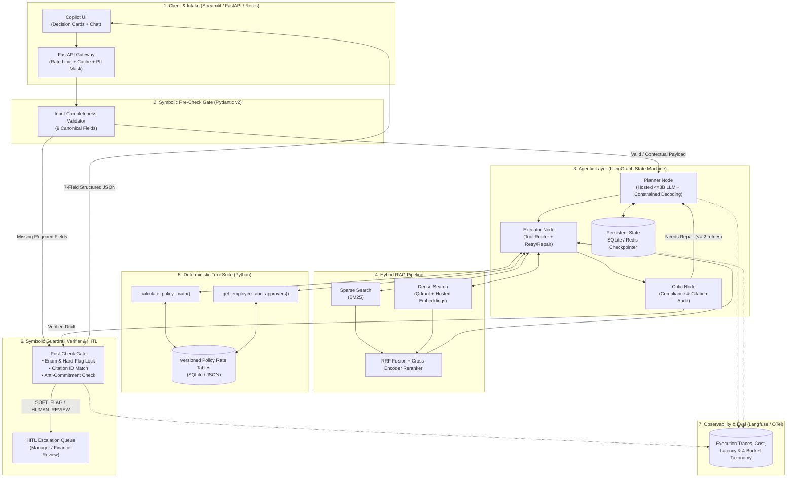

# System Architecture: T&E Policy Agent (Hybrid Neuro-Symbolic Design)

**Document type:** System Architecture & Implementation Blueprint  
**Project:** Travel & Expense (T&E) Policy Agent  
**Reference Scope:** `project_scope.md` | **Eval Benchmark:** `data/evaluation/gold_eval_v1.jsonl`

---

## 1. Architectural Philosophy: Hybrid Neuro-Symbolic Design for $\le 8\text{B}$ Models

Operating a financial compliance copilot on a **hosted instruction model with $\le 8\text{B}$ parameters** (accessed via OpenAI-compatible APIs, with no weight access or fine-tuning) requires isolating semantic reasoning from deterministic policy enforcement. Compact instruction models handle intent parsing, structured tool calls, and grounded explanation well, but they struggle with multi-step arithmetic, strict schema adherence, and citation faithfulness if left unconstrained.

This system enforces a **Hybrid Neuro-Symbolic Architecture**:

* **Symbolic Layer (Deterministic Python & Rules Engine):** Validates required inputs, executes all arithmetic (per diems, mileage, hotel/meal cap variances), resolves approval hierarchies, and enforces post-generation guardrail locks.
* **Neural Layer (Hosted $\le 8\text{B}$ LLM + Hosted Embeddings + Reranker):** Interprets employee requests, orchestrates tool calls via a bounded **Planner → Executor → Critic** loop, retrieves policy clauses via Hybrid RAG, and synthesizes clear, policy-grounded explanations.

> **Core Principle:** The neural model *explains and recommends*; the symbolic layer *calculates, validates, and enforces*. The LLM can never override a symbolic `HARD_FLAG`, invent a limit, fabricate a citation, or substitute for a human approval signature.

---

## 2. End-to-End Technology Stack & Tooling Matrix

| Architectural Layer / Step | Primary Technologies & Libraries | Role in the Pipeline |
| :--- | :--- | :--- |
| **1. Client & Intake** | **Streamlit** (or React + Vite), **FastAPI**, **SlowAPI / Redis** | Interactive UI with structured decision cards, multi-turn chat, API gateway, and per-user rate limiting. |
| **2. Symbolic Pre-Check Gate** | **Python 3.11+**, **Pydantic v2** | Enforces the 9-field canonical input contract; short-circuits missing required fields to `NEEDS_INFORMATION`. |
| **3. Corpus Ingestion & Hybrid RAG** | **Docling / Unstructured**, **rank-bm25**, **Qdrant** (or Chroma/pgvector), **Hosted Embeddings API**, **FlashRank / Cohere / BGE Reranker** | Section-aware & table-preserving chunking, BM25 + dense vector search, Reciprocal Rank Fusion (RRF), and cross-encoder reranking. |
| **4. Agent Orchestrator** | **LangGraph** (with **SQLite / Redis** checkpointer) | Explicit **Planner → Executor → Critic** state machine, persistent multi-turn memory, loop caps, and token budgets. |
| **5. Hosted LLM & Constrained Decoding** | **OpenAI Python SDK** (`openai>=1.x`), **Instructor** / JSON Schema `response_format`, **Tenacity** | Connects to hosted $\le 8\text{B}$ model (e.g., Llama-3.1-8B-Instruct, Qwen-2.5-7B-Instruct via Groq/Together/vLLM/OpenRouter) with `T = 0.0`, constrained decoding, and schema-repair retries. |
| **6. Symbolic Tools & Policy Engine** | **Python 3.11+**, **SQLite / PostgreSQL**, **YAML/JSON Rate Tables** | Deterministic execution of `validate_request_inputs`, `search_policy_corpus`, `calculate_policy_math`, and `get_employee_and_approvers`. |
| **7. Guardrail Verifier & HITL** | **Pydantic v2**, Regex/ID Verifier, **Presidio** (PII masking) | Enforces 5-state decision enum, locks `HARD_FLAG`, verifies citations against retrieved chunks, masks PII, and routes escalations. |
| **8. Observability, Caching & Deployment** | **Langfuse** (or LangSmith / OpenTelemetry), **Redis**, **Docker & Docker Compose**, **Pytest** | Full trace logging, 4-bucket failure taxonomy, embedding/query caching, and containerised deployment. |

---

## 3. High-Level System Architecture



---

## 4. Step-by-Step Implementation Details

### Step 1: Client, API Gateway, Caching & Rate Limiting
* **Tools:** `FastAPI`, `Streamlit` (or React), `Redis`, `SlowAPI`, `Microsoft Presidio` (or regex PII scrubber).
* **Implementation:**
  1. **UI Layer:** Render a two-pane interface—a multi-turn chat/form panel for employee queries and a structured **Decision Card** displaying the status badge (`PASS`, `SOFT_FLAG`, `HARD_FLAG`, `NEEDS_INFORMATION`, `HUMAN_REVIEW`), allowed amount, policy citation snippets, and required approver.
  2. **Rate Limiting & Caching:** Apply per-user/IP sliding-window rate limits (e.g., 20 requests/min) via `SlowAPI` + `Redis`. Cache hosted embedding vectors (keyed by SHA-256 of query text) and identical read-only policy lookups with a 24-hour TTL to reduce latency and API spend.
  3. **PII Redaction:** Scrub sensitive identifiers (employee names, card numbers, phone numbers) before writing logs to observability sinks, while retaining pseudonymous `employee_id` tokens for HR tool lookups.

### Step 2: Symbolic Pre-Check Gate (Input Completeness Validator)
* **Tools:** `Pydantic v2`, `Python 3.11+`.
* **Implementation:**
  1. Normalize incoming payloads into the 9 canonical fields: `employee_id`, `employee_grade`, `department`, `travel_destination`, `travel_dates`, `expense_category`, `expense_amount`, `receipt_info`, and `project_code`.
  2. Run category-specific completeness rules (e.g., `hotel_accommodation` requires `employee_grade`, `travel_destination`, and `travel_dates`; any expense claim $> ₹1,000$ requires `receipt_info`).
  3. **Short-Circuit Behavior:** If any mandatory field is `null` or malformed, bypass the LLM entirely and emit a deterministic `NEEDS_INFORMATION` payload listing the exact `missing_required_fields`. This guarantees the $\le 8\text{B}$ model never guesses missing grades or treats missing receipts as approval.

### Step 3: Policy Corpus Ingestion & Hybrid RAG Pipeline
* **Tools:** `Docling` / `PyMuPDF`, `rank-bm25`, `Qdrant` (local Docker container), Hosted Embeddings API, `FlashRank` (or `bge-reranker-base` / Cohere Rerank API).
* **Implementation:**
  1. **Corpus Preparation (500–2,000 docs):** Ingest corporate T&E policies, city-tier hotel/per diem rate tables, mileage circulars, receipt rules, and approval matrices.
  2. **Table-Preserving & Header-Aware Chunking:** Split documents on Markdown/section headings so policy clauses stay intact. Keep rate tables whole as single chunks (or parent-child chunks) so city-tier caps are never severed from their column headers.
  3. **Metadata Tagging:** Attach `{doc_id, section_id, policy_ref, region, grade_scope, expense_category, effective_date}` to every chunk (e.g., `policy_ref: "POL-TRV-03#2.1"`).
  4. **Hybrid Retrieval + Reranking:**
     * Execute **BM25** (top-25) for exact lexical matches (`L4`, `POL-TRV-02`, `Bengaluru`, `GSTIN`).
     * Execute **Dense Vector Search** in Qdrant (top-25) using the hosted embeddings endpoint for semantic matching.
     * Fuse both lists via **Reciprocal Rank Fusion (RRF)** and pass the top-15 candidates through the **Cross-Encoder Reranker** to return the top 3–5 highest-precision chunks.
  5. **Low-Confidence Gate:** If the top reranked chunk falls below a calibrated relevance threshold (e.g., unlisted destination like Thimphu or Antarctica), return an explicit `NO_POLICY_EVIDENCE` signal to trigger `HUMAN_REVIEW`.

### Step 4: Deterministic Symbolic Tool Suite
* **Tools:** `Python 3.11+`, `Pydantic v2`, `SQLite / PostgreSQL` (versioned rate tables).
* **Implementation:** Expose 4 strictly typed tools to the agent orchestrator:
  1. `validate_request_inputs(payload)` → Returns `{is_complete: bool, missing_fields: list[str]}`.
  2. `search_policy_corpus(query, filters)` → Executes Step 3 Hybrid RAG and returns grounded chunks with exact `policy_ref` IDs and reranker scores.
  3. `calculate_policy_math(category, amount, currency, days, distance_km, city_tier, grade, attendees)` → Performs exact Python arithmetic for hotel cap overages ($\%$), multi-day per diems, personal car ($₹12/\text{km}$) / two-wheeler ($₹6/\text{km}$) mileage, and per-head client entertainment caps. Returns `{allowed_amount, claimed_amount, variance_amount, variance_pct, band: "WITHIN_CAP" | "SOFT_BAND" | "HARD_BREACH"}`.
  4. `get_employee_and_approvers(employee_id, violation_type, amount)` → Checks probation/eligibility status, segregation-of-duties (blocks self-approval), and resolves the exact `required_approval_level` (`NONE`, `LINE_MANAGER`, `DEPARTMENT_HEAD`, `FINANCE_CONTROLLER`, `VP_OR_DIRECTOR`, `HUMAN_COMPLIANCE_REVIEW`, `CANNOT_BE_APPROVED`).

### Step 5: Agentic Layer & Small-Model Tool-Calling Resilience
* **Tools:** `LangGraph`, `OpenAI Python SDK`, `Instructor` (or native JSON Schema `response_format`), `Tenacity`, `SQLite/Redis` checkpointer.
* **Implementation:**
  1. **Explicit Planner → Executor → Critic Loop:**
     * **Planner Node:** Calls the hosted $\le 8\text{B}$ model (`temperature=0.0`) with constrained JSON decoding to select the next tool call or draft the final 7-field JSON output.
     * **Executor Node:** Runs the requested deterministic tool, catches timeouts/exceptions gracefully, and appends structured observations to the graph state.
     * **Critic Node:** Audits the Planner's draft against retrieved chunks and tool outputs—checking for missing citations, arithmetic mismatches, or attempted hard-flag overrides.
  2. **Small-Model Resilience Mechanics:**
     * **Constrained Decoding & Pydantic Validation:** Every tool call and final response is parsed into a strict Pydantic model.
     * **Self-Repair Retry Loop:** If the $\le 8\text{B}$ model emits malformed JSON, invalid enum values, or wrong argument types, the exact Pydantic `ValidationError` is fed back to the Planner for up to **2 retries**. If retries exhaust, the graph fails safely to `HUMAN_REVIEW`.
     * **Hard Runtime Caps:** Enforce `max_iterations = 5` (preventing infinite loops) and a per-query token budget cap (e.g., `max_total_tokens = 6,000`).
  3. **Persistent Multi-Turn State:** Persist conversation state by `session_id` in SQLite/Redis so when the agent returns `NEEDS_INFORMATION` and the employee replies with their grade or receipt status, the graph resumes seamlessly.

### Step 6: Symbolic Guardrail Verifier & HITL Escalation
* **Tools:** `Python 3.11+`, `Pydantic v2`.
* **Implementation:** Runs deterministically on the final draft *after* the LangGraph loop completes:
  1. **Decision Enum Lock:** Verifies `decision_category` $\in \{\text{PASS}, \text{SOFT\_FLAG}, \text{HARD\_FLAG}, \text{NEEDS\_INFORMATION}, \text{HUMAN\_REVIEW}\}$.
  2. **Hard-Flag Lock:** If any symbolic tool returned `HARD_BREACH` or a prohibited category (e.g., First Class, spa/mini-bar, govt gift, >90-day claim), locks `decision_category = "HARD_FLAG"` and `required_approval_level = "CANNOT_BE_APPROVED"`.
  3. **Citation Grounding Check:** Cross-checks every string in `applicable_policy_references` against the set of `policy_ref` IDs returned by `search_policy_corpus` in the current trace. Any fabricated citation is stripped and escalates the case to `HUMAN_REVIEW`.
  4. **Numeric & Anti-Commitment Check:** Confirms `allowed_expense_amount` matches `calculate_policy_math` output (or `null` when no rule exists) and appends an immutable advisory notice (`"AI assessment only. Final approval requires authorized human sign-off."`).
  5. **HITL Routing:** Packages `SOFT_FLAG` and `HUMAN_REVIEW` outputs with policy citations and employee justifications into the approval queue for authorized managers or Finance Controllers.

### Step 7: Observability, Evaluation & Containerised Deployment
* **Tools:** `Langfuse` (or LangSmith / OpenTelemetry), `Pytest`, `Docker`, `Docker Compose`.
* **Implementation:**
  1. **End-to-End Tracing:** Emit a trace per `request_id` capturing normalized inputs, BM25/dense/reranker top-$k$ IDs and scores, LLM prompts/completions, token counts, retry counts, tool latencies, and Guardrail Verifier flags.
  2. **Automated Evaluation & 4-Bucket Failure Taxonomy:** Run batch evaluations against `data/evaluation/gold_eval_v1.jsonl` (80 queries), measuring standalone **Retrieval Recall@k** ($k=3, 5, 10$), end-to-end decision accuracy, citation faithfulness, task completion rate, average tool calls, and cost/latency per query. Classify every failure into:
     * `RETRIEVAL_MISS` (gold `policy_ref` absent from reranked top-$k$)
     * `TOOL_CALL_ERROR` (wrong tool, invalid args, malformed JSON, or exhausted retries)
     * `REASONING_ERROR` (correct context & tool math available, but wrong classification)
     * `HALLUCINATION` (invented limit, fabricated citation, or unsupported commitment)
  3. **Containerisation:** Package `frontend` (Streamlit/React), `backend` (FastAPI + LangGraph), `qdrant`, and `redis` in a single `docker-compose.yml` with environment-driven API keys for the hosted $\le 8\text{B}$ LLM and embeddings endpoints.

---

## 5. Standardized 7-Field Output Contract

```json
{
  "request_id": "req_9f8a7b6c",
  "decision_category": "SOFT_FLAG",
  "applicable_policy_references": ["POL-TRV-03#2.1", "POL-EXC-01#1.2"],
  "allowed_expense_amount": {
    "value": 16000,
    "currency": "INR"
  },
  "violation_category": "HOTEL_CAP_EXCEEDED_WITHIN_EXCEPTION_BAND",
  "violation_explanation": "Tier-1 hotel cap for Grade L4 is Rs 8,000/night (Rs 16,000 for 2 nights). Claimed Rs 18,400 (Rs 9,200/night) exceeds the cap by 15% (Rs 2,400), which falls within the <=20% soft-exception band.",
  "recommended_action": "Attach conference surge justification and route to Line Manager for exception approval.",
  "required_approval_level": "LINE_MANAGER",
  "missing_required_fields": [],
  "requires_human_approval": true,
  "advisory_notice": "AI assessment only. Final approval requires authorized human sign-off."
}
```